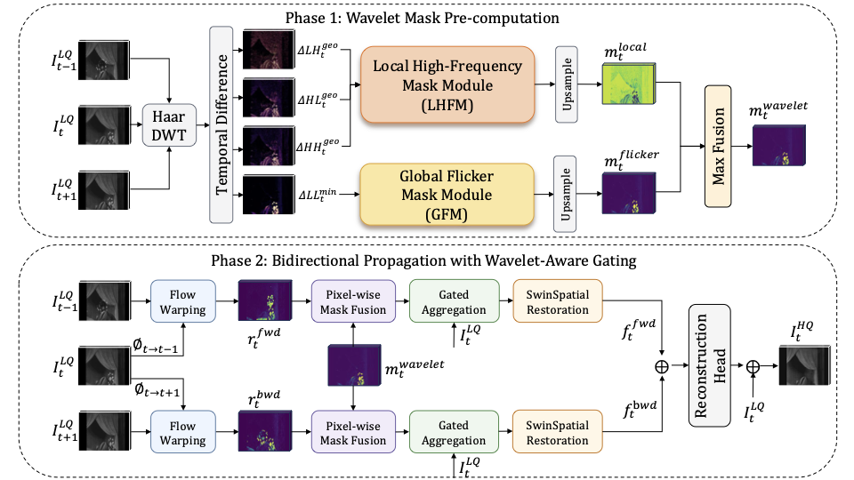
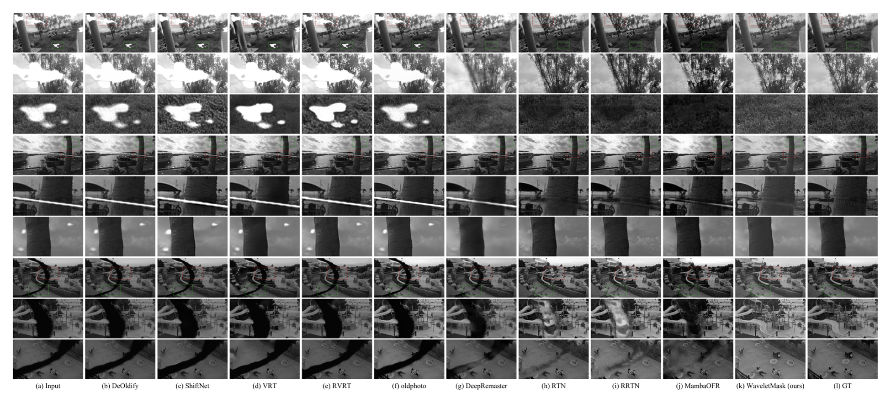
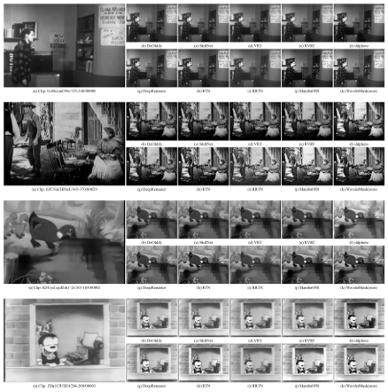
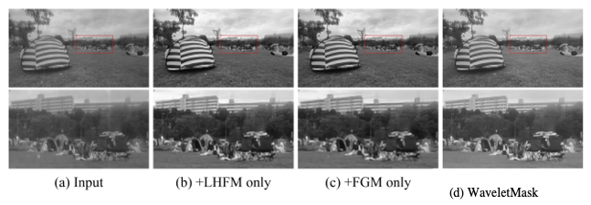

# WaveletMask

[](https://www.python.org/)
[](https://pytorch.org/)
[](LICENSE)

Official implementation of **WaveletMask: Wavelet-Domain Mask-Guided Degradation Detection for Old Film Restoration**.

WaveletMask augments recurrent old film restoration networks with frequency-specific degradation detection. It decomposes degradation sensing into Haar wavelet sub-bands, using a Local High-Frequency Mask Module (LHFM) for scratches/dust and a Global Flicker Mask Module (GFM) for brightness flicker. The two branch masks are combined by element-wise maximum fusion and then fused with the original RTN spatial indicator to form the gate mask for recurrent aggregation. The detector adds fewer than 1K learnable parameters to the backbone.

> Paper and pretrained weight links will be updated after publication. Source code, evaluation scripts, and configuration files are available now.

## News

- **2026-05-15**: Initial public release with training/testing configs, all ablation variants, and BasicOFR/BasicSR runtime.

## Highlights

- **Frequency-domain degradation detection**: uses Haar DWT to build separate high-frequency (LH/HL/HH) and low-frequency (LL) degradation cues.
- **LHFM for transient local damage**: geometric-mean temporal differencing on detail sub-bands emphasizes frame-specific scratches and dust while suppressing persistent edges and motion.
- **GFM for brightness flicker**: minimum-strategy temporal consensus on the LL sub-band captures frame-level intensity deviations.
- **Parameter-free max fusion**: element-wise maximum preserves the strongest degradation evidence from either branch; learned CNN fusion is systematically ablated.
- **Minimal overhead**: fewer than 1K additional detector parameters on the RTN backbone (∼5.74M total).
- **Reproducible configs**: includes 8 training variants and 16 test configs covering all ablation conditions.

## Method Overview

<p align="center">
  
</p>

<p align="center"><b>WaveletMask pipeline.</b> Phase 1 computes a wavelet-domain mask by fusing LHFM and GFM responses. Phase 2 combines the wavelet mask with the directed RTN spatial indicators through pixel-wise maximum fusion to form the gate masks used by bidirectional recurrent aggregation.</p>

## Qualitative Results

### Synthetic Old Film Restoration (SRWOV/REDS)

<p align="center">
  
</p>

<p align="center"><b>Synthetic old-film restoration.</b> WaveletMask reduces scratch and dust residuals more completely than the baseline methods in selected SRWOV synthetic examples. ROI crops highlight local damage regions. See the paper for full quantitative tables.</p>

### Real-World Archival Footage (SRWOV Real-World)

<p align="center">
  
</p>

<p align="center"><b>Real-world archival footage.</b> WaveletMask suppresses visible flicker and local damage while preserving original film grain on SRWOV real-world clips. No ground truth is available for this split.</p>

## Experimental Analysis

### Component Ablation

<p align="center">
  
</p>

<p align="center"><b>Ablation visual comparison.</b> LHFM tends to affect local scratches; GFM tends to affect frame-level brightness; the combined WaveletMask incorporates both cues. See Table 4 in the paper for full-reference metrics.</p>

### Key Results (SRWOV Synthetic Benchmark)

| Method | PSNR↑ | SSIM↑ | LPIPS↓ | DISTS↓ |
|--------|-------|-------|--------|--------|
| RTN (re-trained) | 26.16 | 0.8917 | 0.1034 | 0.0953 |
| MambaOFR | 25.99 | 0.9059 | 0.0815 | 0.0822 |
| **WaveletMask (ours)** | **26.60** | 0.8951 | 0.0891 | 0.0831 |

WaveletMask achieves +0.44 dB PSNR over the re-trained RTN baseline under the controlled SRWOV synthetic protocol. Other methods' numbers are reported from published benchmark tables. See the paper for the full SOTA comparison with source attribution.

### Fusion Strategy Ablation

| Variant | LHFM | GFM | Fusion | PSNR↑ |
|---------|------|-----|--------|-------|
| RTN baseline | — | — | — | 26.16 |
| +LHFM | ✓ | — | max | 26.38 |
| +LHFM + learned | ✓ | — | CNN | 25.99 |
| +GFM | — | ✓ | max | 26.10 |
| +GFM + learned | — | ✓ | CNN | 25.95 |
| **WaveletMask** | ✓ | ✓ | max | **26.60** |
| WaveletMask + gated | ✓ | ✓ | gated CNN | 26.35 |
| WaveletMask + learned | ✓ | ✓ | max+CNN | 24.98 |

Every learned-fusion variant underperforms its non-learned counterpart under the tested training recipe. The parameter-free maximum rule is the proposed method.

## Quick Start

### Requirements

```bash
conda create -n waveletmask python=3.10 -y
conda activate waveletmask
pip install -r requirements.txt
```

Additional manual installs:
```bash
# PyTorch (select your CUDA version)
pip install torch==2.0.1 torchvision==0.15.2

# PyWavelets (for DWT)
pip install PyWavelets pytorch_wavelets
```

### Dataset Preparation

- **Training**: REDS dataset with on-the-fly synthetic degradation (scratches, dust, blotches, flicker, grain).
- **Evaluation**: SRWOV benchmark (synthetic + real-world splits).

```bash
# Link or copy datasets
ln -s /path/to/REDS datasets/train/REDS
ln -s /path/to/SRWOV datasets/test/SRWOV
```

### Training

```bash
# Train the proposed WaveletMask variant (A+B max fusion)
python scripts/train.py -opt options/train/waveletmask_ab.yml

# Train the RTN baseline (for fair comparison)
python scripts/train.py -opt options/train/waveletmask_base.yml

# Train ablation variants
python scripts/train.py -opt options/train/waveletmask_local.yml     # LHFM only
python scripts/train.py -opt options/train/waveletmask_flicker.yml   # GFM only
python scripts/train.py -opt options/train/waveletmask_full.yml      # A+B+CNN (ablation)
```

### Testing

```bash
# Evaluate on SRWOV synthetic split
python scripts/test.py -opt options/test/waveletmask_ab_synthetic_best.yml

# Evaluate on SRWOV real-world split
python scripts/test.py -opt options/test/waveletmask_ab_realworld_best.yml
```

## Repository Structure

```
WaveletMask-release/
├── waveletmask/              # Project-specific code
│   ├── archs/
│   │   ├── components/wavelet_mask/  # Core modules (Haar DWT, WaveletNoiseMask, PixelWiseMaskFusion)
│   │   ├── waveletmask_ab_arch.py    # ★ Proposed WaveletMask (A+B max fusion)
│   │   └── waveletmask_*_arch.py     # Ablation variants
│   └── models/
│       └── waveletmask_model.py      # Training/test model
├── basicofr/                 # OFR framework (archs, models, data, losses, metrics)
├── basicsr/                  # BasicSR runtime
├── options/
│   ├── train/                # 9 training configs
│   └── test/                 # 16 test configs
├── scripts/                  # train.py, test.py, inference.py
├── tests/                    # Smoke tests
├── assets/figures/           # README figures
└── docs/                     # RESULTS.md, DATASETS.md, MODEL_ZOO.md
```

## License

This project is released under the Apache 2.0 License. See [LICENSE](LICENSE).

## Citation

If you use this code in your research, please cite:

```bibtex
@article{cai2026waveletmask,
  title={WaveletMask: Wavelet-Domain Mask-Guided Degradation Detection for Old Film Restoration},
  author={Cai, Feifan and Zhang, Qi and Xu, Chang-An and Ding, Youdong},
  journal={Applied Sciences},
  year={2026},
  note={Under review}
}
```

## Acknowledgments

The authors thank the developers of RTN for releasing their code and pretrained models. This work builds on BasicSR and the SRWOV benchmark.
